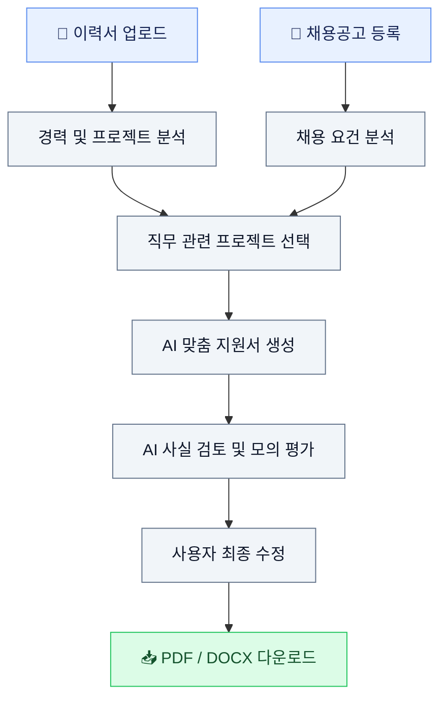
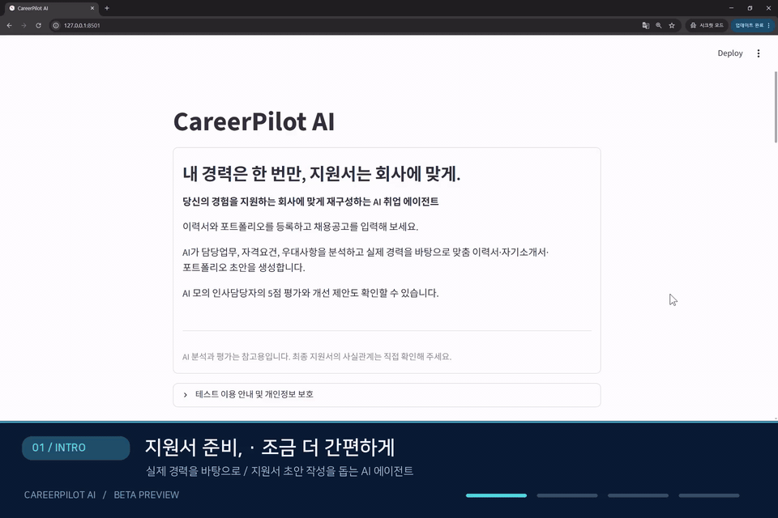

<div align="center">

<h1>🚀 CareerPilot AI</h1>

<h3>내 경력은 한 번만, 지원서는 회사에 맞게.</h3>

<p><strong>Your Career, Your Next Opportunity.</strong></p>

<p>
실제 경험을 기반으로 채용공고에 맞는 지원서 초안을 생성하는<br>
AI-Powered Personalized Career Agent
</p>

<p>


</p>

<p>


</p>

<b>Resume Analysis · Job Matching · AI Document Generation</b>

</div>

---

## 💡 About CareerPilot AI

지원하는 회사마다 이력서와 자기소개서를 다시 수정해야 하는
반복적인 과정을 줄이기 위해 시작한 프로젝트입니다.

**CareerPilot AI**는 기존 이력서와 채용공고를 분석하고,
사용자가 실제로 수행한 프로젝트와 경력을 기반으로
맞춤형 지원서 초안을 작성하도록 돕는 AI 커리어 에이전트입니다.

단순한 문서 생성을 넘어, 경력 검토부터 직무 분석,
지원서 작성 및 AI 피드백까지 하나의 흐름으로 연결합니다.

### 🎯 Our Goals

- 실제 경력을 기반으로 맞춤형 지원서 작성
- 채용공고와 관련된 프로젝트 및 경험 추천
- 반복적인 이력서 수정 작업 감소
- 허위 경력 생성 위험 최소화
- 취업 준비생의 피드백을 통한 서비스 개선

---

## ✨ Key Features

| | Feature | Description |
|:---:|---|---|
| 📄 | **Resume Analysis** | PDF/DOCX 경력 및 프로젝트 추출 |
| 🎯 | **Job Description Analysis** | 담당업무·필수요건·우대사항 분석 |
| 🔎 | **Project Recommendation** | 직무와 관련된 실제 경험 추천 |
| ✍️ | **Resume Generation** | 채용공고 맞춤 이력서 초안 작성 |
| 📝 | **Cover Letter** | 실제 경력 기반 자기소개서 초안 작성 |
| 📂 | **Portfolio Draft** | 관련 프로젝트 기반 포트폴리오 초안 |
| 🤖 | **AI Review** | 사실 검토 및 개선 제안 |
| 📊 | **HR Simulation** | 모의 인사담당자 관점의 5점 평가 |
| 📥 | **Document Export** | DOCX/PDF 다운로드 |

> **Note**
>
> AI 분석과 평가는 참고용입니다.
> 실제 합격 가능성을 예측하는 기능이 아니며,
> 최종 문서의 사실관계는 사용자가 확인해야 합니다.

---

## 🔄 How It Works



### 01. Upload Your Resume

PDF 또는 DOCX 형태의 기존 이력서를 등록합니다.

AI가 경력과 프로젝트를 추출하고,
사용자가 분석 결과를 직접 확인하고 수정합니다.

### 02. Analyze Job Description

지원하려는 채용공고를 이미지, PDF 또는 텍스트로 입력합니다.

AI가 담당업무, 필수 자격요건과 우대사항을 분석합니다.

### 03. Generate Personalized Documents

관련 경력과 프로젝트를 선택하면
맞춤 이력서, 자기소개서, 포트폴리오 초안을 생성합니다.

### 04. Review & Export

AI가 작성 결과를 검토하고 개선 의견을 제시합니다.

최종 확인 후 PDF 또는 DOCX로 다운로드합니다.

---

## 🛠 Tech Stack

| Category | Technology |
|---|---|
| **Language** | Python |
| **Frontend** | Streamlit |
| **LLM** | Qwen2.5-7B |
| **Inference** | Ollama |
| **PDF Parsing** | PyMuPDF |
| **OCR** | Tesseract OCR |
| **Document Generation** | python-docx, ReportLab |
| **HTTP Client** | Requests |
| **Usage Counter** | SQLite |
| **Version Control** | Git & GitHub |

---

## 🔐 Privacy & Responsible AI

CareerPilot AI는 개인정보 보호와
사실 기반 경력 분석을 중요하게 생각합니다.

- AI 분석은 기본적으로 서버의 로컬 Ollama 모델을 이용합니다.
- 사용자별 경력 편집과 문서 생성은 Streamlit 세션 기반으로 처리합니다.
- 베타 이용 횟수는 별도 카운터로 관리합니다.
- 실제 개인정보가 포함된 이력서 대신 가상 또는 비식별 테스트 자료 사용을 권장합니다.
- 세션 격리, 저장 경로 및 접근 보안에 대한 배포 검증을 진행합니다.

**현재는 개인정보 보호와 운영 안정성을 검증 중인 베타 프로젝트입니다.**

Streamlit 세션 데이터도 서버에서 처리되므로,
개인정보가 절대 저장되거나 유출되지 않는다고 보장하지 않습니다.

---

## 🧪 Open Beta

CareerPilot AI는 사용자 경험을 검증하기 위한
초기 베타 테스트를 준비하고 있습니다.

| Item | Beta Plan |
|---|---|
| Registration | No Sign-up |
| Experience | 최대 50회 생성 시작 |
| Session Limit | 세션당 최대 2회 |
| Feedback | 사용자 설문 및 의견 수집 |
| Primary Goal | 사용성·정확성·서비스 수요 검증 |

> 50회는 50명의 고유 사용자를 의미하지 않습니다.
> 실제 이용 제한은 실행 중인 베타 서버에서 적용됩니다.

---

## ⚙️ Getting Started

### Requirements

- Python 3.11 권장
- Ollama
- Tesseract OCR
- 한국어 OCR 언어팩 및 글꼴

### Install Dependencies

```bash
pip install -r requirements.txt
```

Ubuntu/Debian:

```bash
apt-get update
apt-get install -y tesseract-ocr tesseract-ocr-kor fonts-nanum
```

### Download Model

```bash
ollama pull qwen2.5:7b
```

### Run Application

```bash
OLLAMA_MODEL=qwen2.5:7b \
streamlit run app.py \
--server.address 127.0.0.1 \
--server.port 8501
```

Local URL:

`http://127.0.0.1:8501`

외부 베타 배포를 위해서는 HTTPS,
네트워크 접근 통제, 개인정보 처리 점검이 필요합니다.

---

## 🗺️ Roadmap

- [x] PDF/DOCX 이력서 분석
- [x] 채용공고 분석
- [x] 관련 프로젝트 추천
- [x] 맞춤 지원서 초안 생성
- [x] AI 모의 인사담당자 평가
- [x] PDF/DOCX 다운로드
- [x] Qwen2.5-7B 연동
- [ ] 사용자 간 데이터 분리 최종 검증
- [ ] 베타 사용량 제한 통합 테스트
- [ ] 공개 베타 안정성 검증
- [ ] 사용자 피드백 수집 및 개선
- [ ] 경력 분석 및 사실 검증 정확도 향상

---

## 💬 Feedback & Contributions

CareerPilot AI는 실제 취업 준비생들의 의견을 바탕으로
개선해 나가는 개인 AI 프로젝트입니다.

사용 과정에서 불편했던 점, 필요한 기능,
개선 아이디어를 자유롭게 공유해 주세요.

GitHub Issues 또는 추후 안내되는
베타 피드백 채널을 통해 의견을 받을 예정입니다.

---

<div align="center">

<h3>🚀 CareerPilot AI</h3>

<p><strong>Make Your Experience Count.</strong></p>

<p>Built with Python · Streamlit · Ollama</p>

<p>Made for Better Career Preparation.</p>

</div>


---

## 🎬 CareerPilot AI Demo

CareerPilot AI의 이력서 등록, 채용공고 입력,
AI 맞춤 지원서 및 평가 기능을 소개합니다.

<div align="center">



</div>

---
